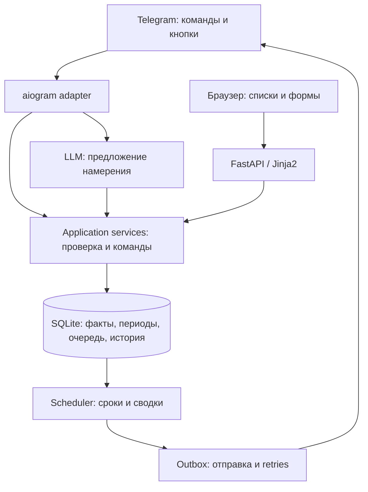

# Архитектура MVP

## Стек

Python 3.12 production, >=3.12,<3.14 development; uv и committed uv.lock.
FastAPI/Uvicorn, Jinja2, небольшие vanilla JS/CSS. aiogram 3 для Telegram.
SQLAlchemy 2 async + aiosqlite; Alembic; Pydantic 2; zoneinfo + tzdata.
pytest/pytest-asyncio/httpx и Ruff. Версии пакетов Claude закрепляет lock-файлом
после совместной проверки, а не устанавливает безграничный latest при каждом старте.
Первый реальный LLM adapter — официальный OpenAI Python SDK / Responses API через узкий
интерфейс, плюс fixture adapter. Пользователь уже имеет OpenAI API key.

Выбор SQLite — инженерное решение для одного владельца и коротких транзакций. Нужен
локальный диск и одна реплика. Отдельные React/Redis/Celery/PostgreSQL сейчас добавили бы
сервисы и сборку без необходимой продуктовой функции.

## Схема



## Один сервис, несколько внутренних циклов

Один контейнер, один Uvicorn worker; FastAPI lifespan поднимает Telegram polling,
scheduler и sender. Общий domain/application слой для web, Telegram и LLM-команд.
Локальный process lock запрещает вторую реплику на том же data volume. Нельзя полагаться
только на in-memory flag. Scheduler периодически читает сохранённые записи (30 секунд),
а не ставит длительные asyncio sleep на каждый дедлайн. LLM выполняется асинхронно вне
транзакций с ограниченным timeout; его отказ не блокирует scheduler.

SQLite: WAL, foreign_keys=ON, busy_timeout; короткие транзакции, optimistic version
на изменяемых сущностях. Не держать transaction во время Telegram/LLM HTTP. Любая
операция последовательно пишет изменение, audit и план уведомлений в одной транзакции.

## Проектируемая структура — Claude создаёт по этапам

```text
src/xboct/
  config.py, main.py
  domain/        # время, повторы, статусы, прогноз; без сетевых SDK
  application/   # команды, поиск, read models, undo, dispatch rules
  storage/       # SQLAlchemy, transactions, repositories
  llm/           # provider interface, fixture, OpenAI Responses adapter
  telegram/      # inbox, handlers, callbacks, transport
  web/           # routes, auth, templates, static
  scheduling/    # planner, persistent jobs, outbox sender
alembic/
tests/           # domain, integration, contracts, UI
scripts/         # bootstrap, backup/restore, smoke checks
```

## Веб-доступ

Собственное веб-приложение; Telegram Mini App — те же страницы внутри Telegram
(вход по `initData`, отдельная cookie, см. MINI_APP.md), второго интерфейса нет. Production HTTP только за HTTPS reverse
proxy. Владелец получает одноразовый код через /login в авторизованном личном чате бота,
вводит его в web. Код криптографически случайный, минимум 8 символов, хранится hash,
одноразовый, срок 5 минут, лимит 5 неверных попыток на код + throttling IP/общий лимит.
Сессия — случайный серверный token/hash, Secure/HttpOnly/SameSite cookie, expiry/revoke.
CSRF token и origin check для мутаций, никогда mutation через GET. Login тоже защищён
от CSRF. URL-ссылки и заметки экранировать; запрет javascript: и других активных схем.
Owner Telegram ID задаётся конфигурацией, не «первый кто написал боту».

Offline demo для cloud с fake auth допустим только в явном test режиме, localhost bind;
production должен отказываться стартовать с отключённой авторизацией/пустым owner.

## Отказоустойчивость

Рестарт восстанавливает расписание по БД. Отказ LLM -> template reminders/reports;
отказ Telegram -> queue и диагностический статус в web. Все процессы умерли ->
уведомления временно невозможны, после возврата одна актуальная catch-up сводка.
Нельзя обещать работу при выключенном VPS. Внешний мониторинг вводится до live-пилота.
Backup и restore обязательны; подробности в OPERATIONS.md.
